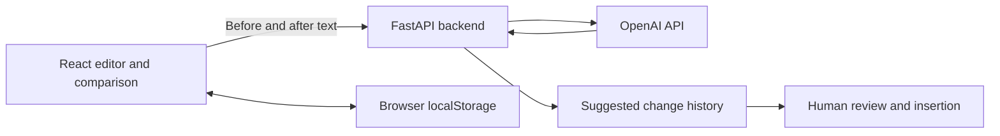

# DocManager

**AI-assisted document review, version comparison and change history.**

[](https://github.com/natgeo1997/docmanager/actions/workflows/ci.yml)

## Problem and approach

Document review involves comparing drafts, describing changes and keeping the reviewer in control. DocManager explores this workflow in a web prototype: edit a sample document, compare versions, request a suggested change-history entry and review it before insertion.

## Features

- Dashboard with sample documents, status and upcoming review dates.
- Integrated editor with browser-local drafts.
- Visual comparison of added and removed text blocks.
- AI-assisted change-history suggestions based on before/after text.
- Human review and editing before inserting the suggestion into the history table.
- Simulated publication of the draft.

## Demonstration — no installation required

[**Try the interactive browser demo →**](https://natalia-practical-ai-demos.natygeo.chatgpt.site/docmanager/index.html)

The hosted demo uses the original React interface in browser-only mode. Edit, compare and save fictional drafts locally. Its summary counts changed text blocks; it does not call OpenAI. The full local application retains the OpenAI integration.

These are actual screenshots of the prototype:

### Dashboard


### AI-assisted change history


### Version comparison


## Architecture and decisions



- **React / JavaScript / Vite / CSS:** editing, comparison and interface.
- **Python / FastAPI:** input validation and model integration. The API key stays in the backend.
- **OpenAI API:** generates a short change description. Instructions restrict it to observed textual changes; this is a prompt constraint, not a guarantee of factual accuracy.
- **Validation:** identical trimmed texts skip the model call. Incomplete responses, empty summaries and summaries without terminal punctuation are rejected. These checks do not establish semantic correctness.
- **Failure handling:** authentication, quota, connection and provider failures return controlled HTTP errors. The client uses a timeout and limited retries.
- **Human control:** the reviewer can edit the suggestion before adding it to the document.

## Run locally

Requirements: Node.js 22 and Python 3.11 are used in CI. Python 3.10+ is supported by the application.

```bash
# From the repository root
python3 -m venv .venv
source .venv/bin/activate
python -m pip install -r backend/requirements.txt
cp backend/.env.example backend/.env
```

Set your own `OPENAI_API_KEY` in `backend/.env`; `OPENAI_MODEL` is optional (see the example file). Never commit a real key.

```bash
cd backend
python -m uvicorn main:app --reload --port 8000
```

In a second terminal, from the repository root:

```bash
npm ci
npm run dev
```

Open [http://localhost:5173](http://localhost:5173). API documentation: [http://localhost:8000/docs](http://localhost:8000/docs).

The interface and local editing can be explored without an API key; generating an AI suggestion requires a configured key and provider access. Before/after text is sent to OpenAI when a suggestion is requested.

## Tests and continuous integration

```bash
python -m pip install -r requirements-dev.txt
python -m pytest -q
npm ci
npm run build
```

[CI](https://github.com/natgeo1997/docmanager/actions) runs backend tests and the frontend production build on pushes and pull requests. Tests mock the provider: no API key, paid calls or real documents are needed. They cover input validation, unchanged text, response checks and error mapping. They do not evaluate model accuracy or exercise the full browser editing workflow.

## Model evaluation

The [evaluation protocol](evaluation/README.md) contains eight fictional before/after pairs, a runner using the actual summary-generation path, lexical checks and a human-review form. A separate opt-in workflow can capture OpenAI responses using a repository secret. Automated checks are limited proxies; they do not establish semantic accuracy. The [recorded evaluation](evaluation/reports/2026-11-02/README.md) includes real responses, measured checks and a documented precision concern. See the [evaluation runs](https://github.com/natgeo1997/docmanager/actions/workflows/evaluate.yml) for execution status and downloadable results.

To build the browser-only mode locally:

```bash
VITE_DEMO_MODE=true npm run build -- --base=/docmanager/
```

## Current limitations

This is a demonstration prototype, not a deployed corporate document-control system. Documents and drafts are stored locally in the browser. There is no authentication, central database, formal approval workflow or durable recoverable history of all versions. Publication is simulated. No measured time savings or production outcomes are claimed.

Use fictional or authorized sample documents. Model suggestions can be incorrect and require human review.
